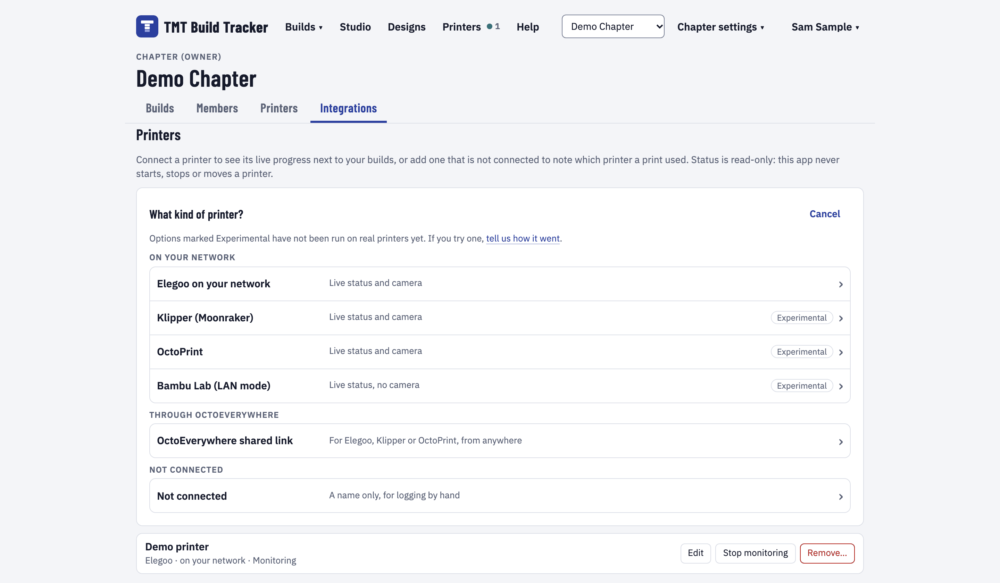
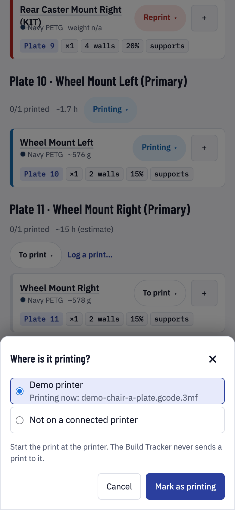
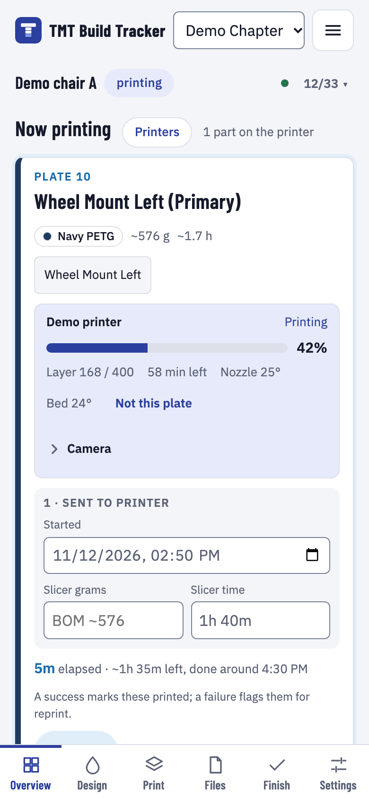

# TMT Build Tracker

A self-hostable web app for makers 3D-printing the MakeGood 3D TMT (toddler mobility trainer) chair. Teams ("chapters") plan, print, assemble and hand off builds together: parts and print plates, filament colors, print logs, a 3D color designer, 3MF export for your slicer, and optional read-only printer status. It has accounts, chapters and roles, and it is made for makers who can run a Docker container, not for developers.

> **Status:** Pre-release, in public testing (see the [changelog](CHANGELOG.md) for the current version). Data formats are stable, but details may change before the first stable release. The Klipper, OctoPrint and Bambu Lab printer connections have not been run against real printers yet. The image is public: `docker pull ghcr.io/ayostepht/tmt-build-tracker:latest` (the newest release). See [Feedback and beta testing](#feedback-and-beta-testing) for how to help.

## Screenshots


Pick the filament for each color slot (primary, accent and so on) and see the chair in those colors. Each slot shows how much filament it needs and whether your stock covers it.


The app lays the parts out flat on the plates for your printer's bed and shows how much of the bed is used. You can export a plate as a 3MF for your slicer.



Optional: add a printer on the Integrations page (Elegoo, Klipper with Moonraker, OctoPrint or Bambu Lab in LAN mode on your network, or Elegoo, Klipper or OctoPrint through an OctoEverywhere shared link, which also works on a hosted site; OctoEverywhere is a separate remote-access service, not part of OctoPrint) to see its status, progress and temperatures next to each plate, or add one that is not connected to log prints by hand. The app only reads from printers; it never starts, stops, pauses or moves them.

<p align="center">
  
</p>

When you start a plate, mark it Printing and say where it is printing. You start the print at the printer itself.

<p align="center">
  
</p>

On your phone at the printer: the plate that is printing, how far along it is and when it should finish. When the plate is done, tap its status badge and choose Printed to mark its parts as printed, or flag a failure so they are queued for a reprint.

## MakeGood files and credit

The MakeGood 3D TMT 3D model and print files are by MakeGood, released as Creative Commons Public Domain (CC0); bundled as a kit pack. Find the design on [MakerWorld](https://makerworld.com/en/models/2066081-3d-toddler-mobility-trainer). One part is not MakeGood's: the experimental one-piece push handle is by jeepxj, under CC BY-NC (attribution, non-commercial), from [MakerWorld](https://makerworld.com/en/models/3409242-3d-toddler-mobility-trainer-one-piece-push-handle). The maker guide is not included: get it from MakeGood.

The git repository itself contains only data about the kit (part names, settings, plate groupings). The converted 3D model and print geometry ship separately as a versioned **kit pack** (a GitHub release asset, about 30 MB), which the Docker image downloads at build time and installs into your `/data` volume on first start, so the standard kit works with nothing to upload. See [docs/kit-pack.md](docs/kit-pack.md) for the format, the environment variables (`KITPACK_DIR`, `KITPACK_URL`, `KITPACK_DOWNLOAD=off`) and how a maintainer builds a pack. Files you import yourself in the kit admin always win over the pack.

## Quick start (about 5 minutes)

You need an always-on machine with Docker (a NAS, a mini PC or a desktop; the image is published for x86-64 and arm64; only x86-64 has been run by the project, so arm64 reports are welcome). On Unraid use the [Unraid guide](docs/guides/unraid.md) instead. The image is public: `docker pull ghcr.io/ayostepht/tmt-build-tracker:latest` needs no login. Tags: `latest` is the newest release; `X.Y.Z` and `X.Y` are specific releases (git tag `vX.Y.Z`); `edge` is the `edge` branch, where pull requests land first and the maintainer reviews them before they reach `main` and a release, for people who want to test unreleased changes and accept that it can break (back up first, and do not expect to go back from `edge` to an older release without restoring that backup if a migration ran); `sha-<short commit>` is one exact build (published for every `main` and `edge` build). You can also build it from source with `docker build -t tmt-build-tracker .` (see [CONTRIBUTING.md](CONTRIBUTING.md)). Allow about 0.5 GB of disk for the image and about 150 MB for the data folder (the installed kit pack).

### 1. Prepare a data folder and a secret

The container runs as the image's `node` user (uid 1000) and cannot write to a folder owned by root, which is what Docker creates if the folder does not exist:

```bash
mkdir -p data && sudo chown 1000:1000 data
echo "BETTER_AUTH_SECRET=$(openssl rand -hex 32)" > tmt.env
```

`tmt.env` holds the secret. Keep a copy somewhere safe (a password manager): the secret signs sessions and encrypts printer access codes, so if you change or lose it everyone is signed out and saved printer access codes must be entered again. Your builds and accounts are not affected.

### 2. Start it

With `docker run`:

```bash
docker run -d --name tmt-build-tracker --restart unless-stopped \
  -p 3000:3000 \
  --env-file tmt.env \
  -v "$PWD/data:/data" \
  ghcr.io/ayostepht/tmt-build-tracker:latest
```

If port 3000 is already in use on the machine, change the first number (for example `-p 3091:3000`) and open that port instead.

Or with Docker Compose. Save this as `docker-compose.yml` next to the `data` folder from step 1 and paste the output of `openssl rand -hex 32` as the secret (use the value from `tmt.env` if you made one; the compose file does not read `tmt.env`):

```yaml
services:
  tmt-build-tracker:
    image: ghcr.io/ayostepht/tmt-build-tracker:latest
    container_name: tmt-build-tracker
    restart: unless-stopped
    ports:
      - '3000:3000'
    volumes:
      - ./data:/data
    environment:
      BETTER_AUTH_SECRET: '' # required: paste the output of  openssl rand -hex 32
      # Set when you serve it over https behind a reverse proxy (no trailing slash):
      # PUBLIC_URL: https://tmt.example.com
      # Extra site admins, besides the first account created:
      # ADMIN_EMAILS: you@example.com
```

Then run `docker compose up -d`. As with `docker run`, if port 3000 is taken change the first number, and `./data` must be owned by uid 1000 (`sudo chown 1000:1000 data`, step 1). The repository's `docker-compose.example.yml` is the same file with every other option (sign-up mode, single sign-on, upload limits, printers) as a commented line: `cp docker-compose.example.yml docker-compose.yml` gives you that one instead. If the pull fails with `unauthorized` or `denied`, see [Image access](#image-access).

Migrations and seeding of the standard kit run automatically at start. The health check is `GET /api/health` (it returns `{"ok":true,"version":"<version>"}` when the database answers, and status 503 otherwise; the version shown is an example).

### 3. First start

1. `docker ps` shows the container as **healthy** after about 20 seconds. If it stops, run `docker logs tmt-build-tracker`: the log says what is wrong (see [Troubleshooting](docs/guides/troubleshooting.md)).
2. The log should show `[tmt] seeded templates: makegood-tmt-revb`, `Listening on http://0.0.0.0:3000`, and within a few seconds `[tmt] kit pack: makegood-tmt-revb <version>: model installed, 40 print geometry row(s)...`. A Better Auth warning "Base URL is not set" is normal while `PUBLIC_URL` is empty.
3. Open `http://<server-ip>:3000`, on the sign-in page choose **Create one** (next to "No account?") and create your account. **The first account created on the install is the site admin** (kit admin pages at `/admin/templates`). More admins can be named in `ADMIN_EMAILS` (case-insensitive; read at start, so restart the container after changing it).
4. The MakeGood kit (model, print geometry, credit) is already installed; nothing to upload. To see it, press **New build** on the page you land on, then **Create build**: a five-step setup opens (Template, Options, Colors, Files, Export) and the 3D chair appears at the Colors step. The in-app **Help** page explains the rest.

**Sign-up is open by default:** anyone who can reach the web page can create an account, and the app sends no email. Keep the port on your LAN, or put it behind a proxy with access control, rather than forwarding it straight to the internet; `SIGNUP=invite` or `SIGNUP=closed` restricts it (see the [environment reference](docs/guides/environment.md)). Builds belong to a person's own workspace or to a chapter, and chapter invitations are copyable `/invite/<id>` links (no email is sent). Forgot a password? See [Backup and upgrade](docs/guides/backup-and-upgrade.md#forgotten-passwords).

Known gap: behind a reverse proxy the sign-in rate limit needs `ADDRESS_HEADER`, and a client that can reach the container port directly could spoof its address when that is set. See [Reverse proxy](docs/guides/reverse-proxy.md#client-address-and-rate-limits).

### Image access

The image is public and is pulled without logging in. If a pull fails with `unauthorized` or `denied`, the usual cause is an old or expired `docker login ghcr.io` on the machine: run `docker logout ghcr.io` and pull again. Check also that the tag exists (for example `latest` or a version such as `X.Y.Z`) and that the name is spelled in lower case.

## Guides

| Guide                                                             | What is in it                                                                                                                                                 |
| ----------------------------------------------------------------- | ------------------------------------------------------------------------------------------------------------------------------------------------------------- |
| [Unraid](docs/guides/unraid.md)                                   | Template or manual install, settings, first start, updating, backups, uninstall                                                                               |
| [Reverse proxy](docs/guides/reverse-proxy.md)                     | `PUBLIC_URL`, Nginx Proxy Manager, Caddy, Traefik, security headers, upload size, live updates                                                                |
| [Single sign-on](docs/guides/sso.md)                              | Generic OpenID Connect, Authentik, Google and GitHub (public mode), who may sign up                                                                           |
| [Backup and upgrade](docs/guides/backup-and-upgrade.md)           | What to back up, restore, updating the image, password reset links                                                                                            |
| [Printers](docs/guides/printers.md)                               | Integrations page, hosted or self-hosted, Elegoo, Klipper (Moonraker), OctoPrint, Bambu LAN, OctoEverywhere links, Docker networking, what the app never does |
| [Environment reference](docs/guides/environment.md)               | Every variable, defaults, limits                                                                                                                              |
| [Troubleshooting](docs/guides/troubleshooting.md)                 | Symptom, cause and fix                                                                                                                                        |
| [Install on your phone](docs/guides/phone-install.md)             | Home screen, offline behaviour                                                                                                                                |
| [Site admin: model and print geometry](docs/guides/site-admin.md) | Replacing the bundled 3D model, importing print geometry from the command line                                                                                |
| [Export for your slicer](docs/guides/slicer-export.md)            | The 3MF export for Elegoo Slicer, OrcaSlicer, Bambu Studio and others                                                                                         |
| [Changelog](CHANGELOG.md)                                         | What changed in each release                                                                                                                                  |

## Feedback and beta testing

This is a pre-release: your data and its formats are stable, but details may still change before the first stable release. The most useful feedback right now:

- Installing from the guide on a machine that is not the maintainer's, and telling us where the guide let you down.
- Klipper (Moonraker), OctoPrint and Bambu Lab connections, which are marked Experimental in the app because they have not been run against real printers yet.
- Using the app on phones other than an iPhone.

To report, use one of the issue forms on [GitHub](https://github.com/ayostepht/TMT-Build-Tracker/issues/new/choose): a [printer connection report](https://github.com/ayostepht/TMT-Build-Tracker/issues/new?template=printer-report.yml) (also welcome when everything worked), a bug report, install or docs feedback, or a feature request. Never paste an OctoEverywhere link, API key, access code or serial number. Security problems go through [SECURITY.md](SECURITY.md), not an issue.

## Development

Contributors: see [CONTRIBUTING.md](CONTRIBUTING.md) (setup with Node 22, commands, conventions) and the code map [docs/architecture.md](https://github.com/ayostepht/TMT-Build-Tracker/blob/edge/docs/architecture.md) (on the `edge` branch). To report a security problem, see [SECURITY.md](SECURITY.md).

## License

MIT, see [LICENSE](LICENSE).

### Filament data

Filament data from [SpoolmanDB](https://github.com/Donkie/SpoolmanDB), MIT licensed (see [THIRD_PARTY.md](THIRD_PARTY.md)). Refresh it with `npm run filaments:update` and commit the regenerated `src/lib/server/filaments/catalog.json`.
