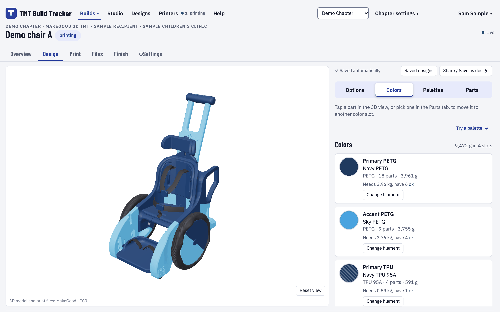
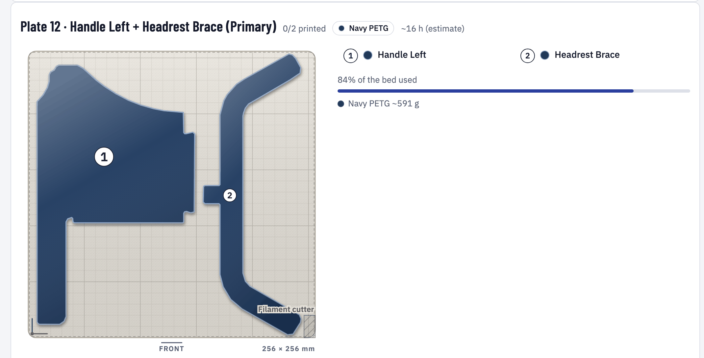
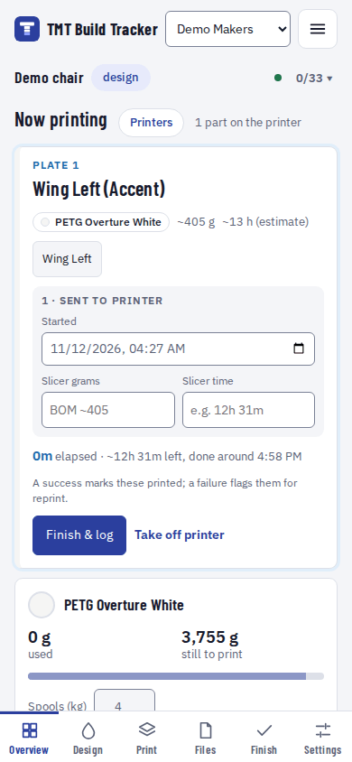
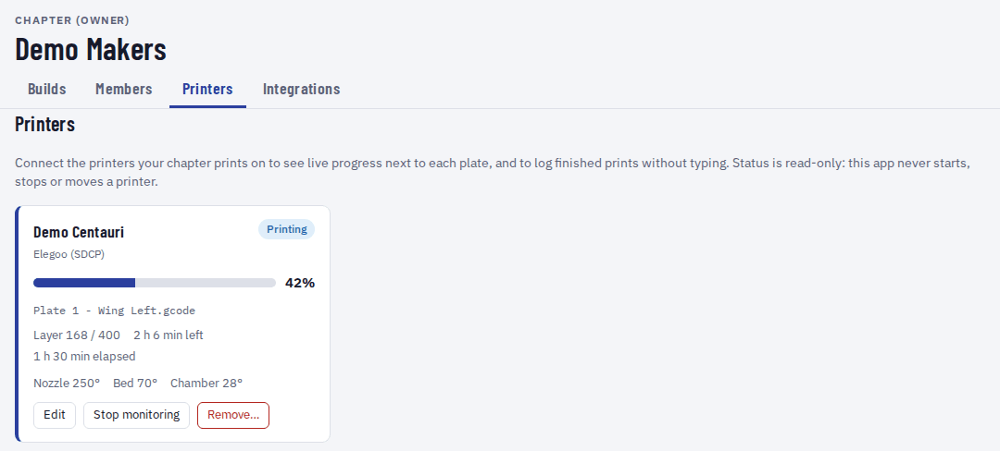

# TMT Build Tracker

A self-hostable web app for makers 3D-printing the MakeGood 3D TMT (toddler mobility trainer) chair. Teams ("chapters") plan, print, assemble and hand off builds together: parts and print plates, filament colors, print logs, a 3D color designer, 3MF export for your slicer, and optional read-only printer status. It has accounts, chapters and roles, and it is made for makers who can run a Docker container, not for developers.

> **Status:** pre-release. The public release (public repository and container package) is still to come. Until then see [Image access](#image-access).

## Screenshots



Pick the filament for each color slot (primary, accent and so on) and see the chair in those colors. Each slot shows how much filament it needs and whether your stock covers it.



The app lays the parts out flat on the plates for your printer's bed and shows how much of the bed is used. You can export the plate as a 3MF for your slicer or start printing it.

<p align="center">
  
</p>

On your phone at the printer: the plate that is printing, how long it has run and when it should finish. When the plate is done, tap the plate's status badge and choose Printed to log it and mark its parts as printed, or flag a failure so they are queued for a reprint.



Optional: add a printer on the Integrations page (Elegoo, Klipper with Moonraker, OctoPrint or Bambu Lab in LAN mode on your network, or Elegoo, Klipper or OctoPrint through an OctoEverywhere shared link, which also works on a hosted site; OctoEverywhere is a separate remote-access service, not part of OctoPrint) to see its status, progress and temperatures next to each plate, or add one that is not connected to log prints by hand. The app only reads from printers; it never starts, stops, pauses or moves them.

## MakeGood files and credit

The MakeGood 3D TMT 3D model and print files are by MakeGood, released as Creative Commons Public Domain (CC0); bundled as a kit pack. Find the design on [MakerWorld](https://makerworld.com/en/models/2066081-3d-toddler-mobility-trainer). The maker guide is not included: get it from MakeGood.

The git repository itself contains only data about the kit (part names, settings, plate groupings). The converted 3D model and print geometry ship separately as a versioned **kit pack** (a GitHub release asset, about 30 MB), which the Docker image downloads at build time and installs into your `/data` volume on first start, so the standard kit works with nothing to upload. See [docs/kit-pack.md](docs/kit-pack.md) for the format, the environment variables (`KITPACK_DIR`, `KITPACK_URL`, `KITPACK_DOWNLOAD=off`) and how a maintainer builds a pack. Files you import yourself in the kit admin always win over the pack.

## Quick start (about 5 minutes)

You need an always-on machine with Docker (a NAS, a mini PC or a desktop; the image is built for x86-64 and arm64). On Unraid use the [Unraid guide](docs/guides/unraid.md) instead. The image is `ghcr.io/ayostepht/tmt-build-tracker`. Tags: `latest` (the main branch), `1.2.3` and `1.2` (release tags `v1.2.3`), and `sha-<short commit>`. Allow about 0.5 GB of disk for the image and about 150 MB for the data folder (the installed kit pack).

### 1. Prepare a data folder and a secret

The container runs as the image's `node` user (uid 1000) and cannot write to a folder owned by root, which is what Docker creates if the folder does not exist:

```bash
mkdir -p data && sudo chown 1000:1000 data
echo "BETTER_AUTH_SECRET=$(openssl rand -hex 32)" > tmt.env
```

`tmt.env` holds the secret. Keep a copy somewhere safe (a password manager): the secret signs sessions and encrypts printer access codes, so if you change or lose it everyone is signed out and saved printer access codes must be entered again. Your builds and accounts are not affected.

### 2. Start it

With `docker run`:

```bash
docker run -d --name tmt-build-tracker --restart unless-stopped \
  -p 3000:3000 \
  --env-file tmt.env \
  -v "$PWD/data:/data" \
  ghcr.io/ayostepht/tmt-build-tracker:latest
```

Or with Docker Compose:

```bash
cp docker-compose.example.yml docker-compose.yml
# edit docker-compose.yml: paste your secret into BETTER_AUTH_SECRET
docker compose up -d
```

`docker-compose.example.yml` maps `./data` to `/data` and publishes port 3000; every optional setting is in it as a commented line. If the pull fails with `unauthorized` or `denied`, see [Image access](#image-access).

Migrations and seeding of the standard kit run automatically at start. The health check is `GET /api/health` (it returns `{"ok":true,"version":"0.9.0"}` when the database answers, and status 503 otherwise; the version shown is an example).

### 3. First start

1. `docker ps` shows the container as **healthy** after about 20 seconds. If it stops, run `docker logs tmt-build-tracker`: the log says what is wrong (see [Troubleshooting](docs/guides/troubleshooting.md)).
2. The log should show `[tmt] seeded templates: makegood-tmt-revb`, `Listening on http://0.0.0.0:3000`, and within a few seconds `[tmt] kit pack: makegood-tmt-revb 1.0.1: model installed, 40 print geometry row(s)...`. A Better Auth warning "Base URL is not set" is normal while `PUBLIC_URL` is empty.
3. Open `http://<server-ip>:3000`, press **Sign up** and create your account. **The first account created on the install is the site admin** (kit admin pages at `/admin/templates`). More admins can be named in `ADMIN_EMAILS` (case-insensitive; read at start, so restart the container after changing it).
4. The MakeGood kit (model, print geometry, credit) is already installed; nothing to upload.

**Sign-up is open by default:** anyone who can reach the web page can create an account, and the app sends no email. Keep the port on your LAN, or put it behind a proxy with access control, rather than forwarding it straight to the internet; `SIGNUP=invite` or `SIGNUP=closed` restricts it (see the [environment reference](docs/guides/environment.md)). Builds belong to a person's own workspace or to a chapter, and chapter invitations are copyable `/invite/<id>` links (no email is sent). Forgot a password? See [Backup and upgrade](docs/guides/backup-and-upgrade.md#forgotten-passwords).

Known gap: behind a reverse proxy the sign-in rate limit needs `ADDRESS_HEADER`, and a client that can reach the container port directly could spoof its address when that is set. See [Reverse proxy](docs/guides/reverse-proxy.md#client-address-and-rate-limits).

### Image access

While the repository is private, the container package is private too and pulling it fails with `unauthorized` or `denied`. Pick one:

- **Make the package public** (once the project is released): on GitHub open your profile or organization, **Packages**, **tmt-build-tracker**, **Package settings**, **Danger Zone**, **Change visibility**, **Public**. Nothing else is needed on the server.
- **Log in to ghcr.io on the server:** create a GitHub **classic** personal access token with only the `read:packages` scope (GitHub does not accept fine-grained tokens for container packages), then run `docker login ghcr.io -u <your GitHub user>` and paste the token at the password prompt. On Unraid the login is stored under `/root`, which lives in RAM, so **it is gone after a reboot**; repeat it before updating the container after a restart.

## Guides

| Guide                                                             | What is in it                                                                                                                                                 |
| ----------------------------------------------------------------- | ------------------------------------------------------------------------------------------------------------------------------------------------------------- |
| [Unraid](docs/guides/unraid.md)                                   | Template or manual install, settings, first start, updating, backups, uninstall                                                                               |
| [Reverse proxy](docs/guides/reverse-proxy.md)                     | `PUBLIC_URL`, Nginx Proxy Manager, Caddy, Traefik, security headers, upload size, live updates                                                                |
| [Single sign-on](docs/guides/sso.md)                              | Generic OpenID Connect, Authentik, Google and GitHub (public mode), who may sign up                                                                           |
| [Backup and upgrade](docs/guides/backup-and-upgrade.md)           | What to back up, restore, updating the image, password reset links                                                                                            |
| [Printers](docs/guides/printers.md)                               | Integrations page, hosted or self-hosted, Elegoo, Klipper (Moonraker), OctoPrint, Bambu LAN, OctoEverywhere links, Docker networking, what the app never does |
| [Environment reference](docs/guides/environment.md)               | Every variable, defaults, limits                                                                                                                              |
| [Troubleshooting](docs/guides/troubleshooting.md)                 | Symptom, cause and fix                                                                                                                                        |
| [Install on your phone](docs/guides/phone-install.md)             | Home screen, offline behaviour                                                                                                                                |
| [Site admin: model and print geometry](docs/guides/site-admin.md) | Replacing the bundled 3D model, importing print geometry from the command line                                                                                |
| [Export for your slicer](docs/guides/slicer-export.md)            | The 3MF export for Elegoo Slicer, OrcaSlicer, Bambu Studio and others                                                                                         |
| [Changelog](CHANGELOG.md)                                         | What changed in each release                                                                                                                                  |

## Development

Contributors: see [CONTRIBUTING.md](CONTRIBUTING.md) (setup with Node 22, commands, conventions) and [docs/architecture.md](docs/architecture.md). To report a security problem, see [SECURITY.md](SECURITY.md).

## License

MIT, see [LICENSE](LICENSE).

### Filament data

Filament data from [SpoolmanDB](https://github.com/Donkie/SpoolmanDB), MIT licensed (see [THIRD_PARTY.md](THIRD_PARTY.md)). Refresh it with `npm run filaments:update` and commit the regenerated `src/lib/server/filaments/catalog.json`.
